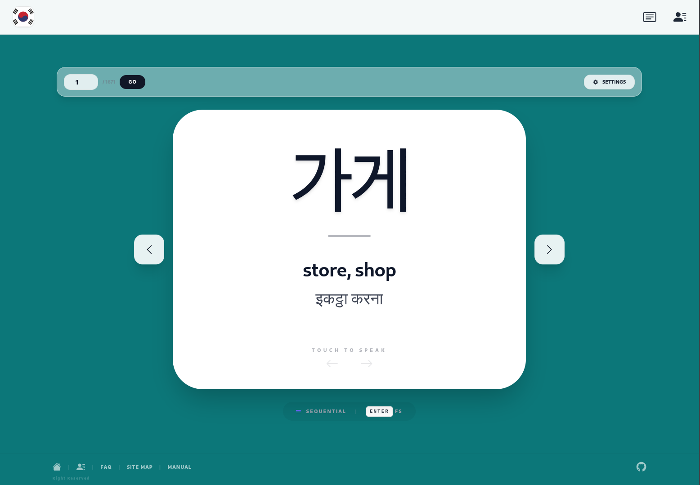

# Vocab Korean

<p align="center">
Learn Korean vocabulary with active recall and spaced repetition, with Hindi and English meanings.
</p>

<p align="center">
  <a href="https://github.com/hariom-jbnu/Vocab-korean">Repository</a>
  •
  <a href="https://vocab.free.nf/?i=1">Live Demo</a>
</p>

---

## Overview

Vocab Korean helps you remember Korean words, not just read them. Each word is shown in Korean first and you answer a short question about it: pick the meaning, pick it by ear, or type the word in Hangul. The app grades the answer itself, and a spaced repetition scheduler (FSRS) brings every word back just before you would forget it.

The platform focuses on:
- Active recall instead of re-reading
- Spaced repetition with the FSRS algorithm
- Hindi and English meanings for every word
- Progress saved in your browser, no account needed
- Optional sign-in to sync progress across devices
- Fast, distraction-free study on desktop and mobile

Built for:
- Korean language learners, especially Hindi speakers
- Students preparing for TOPIK
- Daily vocabulary practice

---

## Features

- **Daily review**: due words first, then a few new words a day in shuffled order
- **Quiz rounds that get harder as you learn**: multiple choice for new words, a listening round once a word sticks, and typing in Hangul for words you know well
- **Automatic grading** from correctness and answer time, so there is nothing to self-rate
- **Hangul feedback**: typed answers are checked letter by letter and a one-letter slip counts as a near miss
- **Flip cards** with Again / Hard / Good / Easy buttons, if you prefer rating yourself
- **FSRS scheduling** through [ts-fsrs](https://github.com/open-spaced-repetition/ts-fsrs), tuned by a single "target recall" setting
- **Stats**: words known, recall over the last 30 days, word stages, a 14-day review forecast and your hardest words
- **Daily goal and streak**, with one missed day a week forgiven
- **Saved progress**: cards and the full review history are stored in IndexedDB
- **Sync across devices** (optional): sign in with an email code or Google and your progress, history and study settings follow you. Studying offline or without an account still works
- **Backup and restore** your progress as a file, or reset it
- **Works offline** and can be installed to the home screen
- **Undo** the last answer
- **Browse mode**: flip through all 1,670 words in order or at random
- **Text-to-speech** in Korean with voice, speed and pitch controls
- **Themes and card colors**, remembered between visits

### Keyboard shortcuts

| Key | Action |
|---|---|
| `1` `2` `3` `4` | Pick a choice in the quiz, or Again / Hard / Good / Easy on flip cards |
| `Space` / `Enter` | Continue after a quiz answer; on flip cards, show answer then rate Good |
| `R` | Play audio |
| `U` | Undo last answer |
| `←` `→` | Previous / next card in Browse |

---

## How it works

1. Every word starts as **new**. You see up to *N* new words a day (10 by default).
2. After each answer, FSRS updates the word's **stability** and **difficulty** and picks the next review date so that your chance of remembering it is about your target recall (90% by default).
3. The question gets harder as a word gets more stable: multiple choice at first, listening from about 3 days, typing from about 3 weeks.
4. Answers are graded automatically. A wrong answer is "Again", a slow or nearly right one is "Hard", a quick typed answer is "Easy".
5. Words you miss come back within the same session; words you know well come back days or months later.
6. Every answer is kept in an append-only log, so the schedule can be re-tuned later without losing progress.
7. A study day rolls over at 4 a.m., so a late-night session still counts for that day.

---

## Preview

| Home Page | Settings Page |
|---|---|
|  |  |

---

## Tech Stack

### Frontend
- **React 19** with **TypeScript**
- **Vite** for development and builds
- **Tailwind CSS 4** via `@tailwindcss/vite`
- **React Router** (hash routing, works on any static host)

### Learning engine
- **ts-fsrs**: FSRS-6 spaced repetition scheduler
- **IndexedDB** (via `idb`): cards and review history
- **localStorage**: settings

### Backend (optional)
- **Supabase**: Auth (email code, Google) and Postgres with row level security for progress sync
- **Vercel**: static hosting with preview deployments for pull requests

### Browser APIs
- **Web Speech API**: Korean text-to-speech
- **Service worker** and web app manifest: offline use and install

### Testing
- **Vitest** with `fake-indexeddb`

---

## Project Structure

```bash
Vocab-korean/
├── data/
│   ├── ko_hi_en_vocab.csv   # Word list: Korean, Hindi, English
│   └── asset/               # README screenshots
├── public/                  # Manifest and app icons
├── supabase/migrations/     # Database tables, security rules and sync functions
├── src/
│   ├── components/          # Quiz rounds, settings panel, footer
│   ├── hooks/               # Review session, daily progress, speech
│   ├── lib/                 # FSRS wrapper, queue, quiz grading, Hangul, stats, sync
│   ├── pages/               # Review, Stats, Browse, Contact
│   ├── sw.js                # Service worker template
│   ├── App.tsx
│   └── main.tsx
├── index.html
├── package.json
├── vercel.json              # Vercel build and cache headers
└── vite.config.ts
```

---

## Quick Start

### Prerequisites

* Node.js 20+
* npm

### Installation

```bash
# Clone repository
git clone https://github.com/hariom-jbnu/Vocab-korean.git

# Enter project directory
cd Vocab-korean

# Install dependencies
npm install

# Start development server
npm run dev

# Run tests
npm test
```

Application runs at:

```bash
http://localhost:3000
```

---

## Production Build

```bash
# Create production build
npm run build

# Preview production build
npm run preview
```

---

## Accounts and Sync

Accounts are optional. Without Supabase settings the app runs fully in the browser, which is also how the tests and CI run.

### How sync works

- IndexedDB stays the working copy, so the app is just as fast and works offline.
- Each answer gets an id made on the device. Answers are uploaded a few seconds after you answer and when you leave the app; the same answer is never stored twice.
- Each word's card keeps the copy that changed last, so studying on a phone and a laptop merges cleanly.
- On your first sign-in, progress made without an account moves into your account.
- Resetting or restoring a backup while signed in applies to all your devices.
- Every table has row level security: a learner can only read and change their own rows.

### Set up Supabase

1. Create a Supabase project.
2. Run [`supabase/migrations/20261110000000_progress_sync.sql`](supabase/migrations/20261110000000_progress_sync.sql) in the SQL editor, or `supabase db push` with the Supabase CLI.
3. In **Authentication > URL Configuration**, set the Site URL to your production URL and add redirect URLs for local development and previews, for example `http://localhost:3000/**` and `https://*-your-team.vercel.app/**`.
4. In **Authentication > Emails**, add `{{ .Token }}` to the *Magic Link* and *Confirm signup* templates so emails include a 6-digit code. The code works inside the installed app, where a link would open the browser instead.
5. Supabase's built-in email only reaches your own team's addresses. Before inviting others, add a custom SMTP provider in **Authentication > Emails > SMTP Settings**, or turn on Google sign-in.
6. Copy `.env.example` to `.env.local` and fill in the project URL and publishable key from **Project Settings > API Keys**.

### Google sign-in (optional)

Create an OAuth client in Google Cloud, add it under **Authentication > Sign In / Providers > Google** in Supabase, then set `VITE_GOOGLE_SIGN_IN=true`.

---

## Deploy to Vercel

1. Import the repository at [vercel.com/new](https://vercel.com/new). The settings in `vercel.json` (Vite, `npm run build`, `dist`) are picked up automatically.
2. Add `VITE_SUPABASE_URL` and `VITE_SUPABASE_PUBLISHABLE_KEY` (and `VITE_GOOGLE_SIGN_IN` if used) under **Settings > Environment Variables** for Production and Preview.
3. Deploy. Every push to `main` deploys to production and every pull request gets a preview URL.

The app uses hash routes (`/#/stats`), so no rewrite rules are needed. `sw.js` is served with `no-cache` so new releases reach installed apps.

---

## Development Goals

* Improve Korean vocabulary retention
* Build distraction-free learning workflows
* Provide scalable vocabulary study tools
* Integrate AI-assisted language learning
* Support modern web performance standards

---

## Roadmap

* Example sentences and cloze cards
* Topic and TOPIK level tags for focused study
* Reverse cards (meaning to Korean)
* Tune FSRS to each learner's own review history

---

## Contributing

Contributions are welcome.

```bash
# Create feature branch
git checkout -b feature/your-feature

# Commit changes
git commit -m "feat: add new feature"

# Push branch
git push origin feature/your-feature
```

Open a Pull Request describing your changes.

---

## Security Notes

* Never commit `.env` files
* Store secrets in `.env.local`
* Only the Supabase publishable key belongs in the app; never use the secret or `service_role` key in frontend code
* Review dependencies regularly
* Validate external API inputs

---

## Support

* Report bugs via GitHub Issues
* Submit feature requests
* Share improvements through Pull Requests

Repository:

* [https://github.com/hariom-jbnu/Vocab-korean](https://github.com/hariom-jbnu/Vocab-korean)

---

## License

This project is licensed under the LICENSE file.

---

## Author
Built by [Hariom Dhakad](https://github.com/py-hariom) & [Hariom Dhakad](https://github.com/hariom-jbnu)

