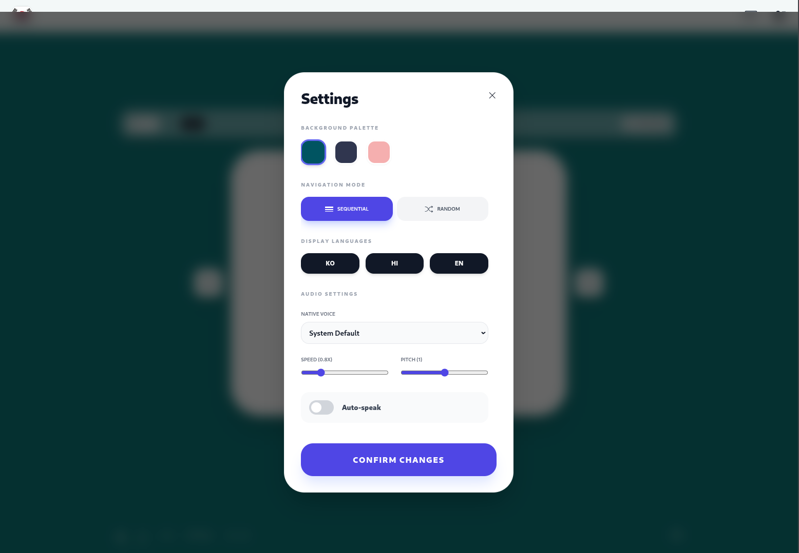

# Vocab — AI Powered Vocabulary Learning Platform

  Learn smarter with AI-powered vocabulary practice, spaced repetition, quizzes, and real-time progress tracking.

---

## Preview

  

  

---

## About

Vocab is a modern vocabulary learning platform designed to help users improve language skills through interactive learning methods and AI-assisted practice.

The platform focuses on:
- Smart vocabulary learning
- Spaced repetition
- Quiz-based retention
- Fast and distraction-free UI
- Real-time progress tracking

Built for students, language learners, exam preparation, and daily vocabulary improvement.

---

## Features

- AI-assisted vocabulary learning
- Flashcards and interactive quizzes
- Spaced repetition system (SRS)
- Daily learning workflow
- Progress tracking and analytics
- Responsive design for mobile and desktop
- Lightweight and fast web experience

---

## Tech Stack

### Frontend
- HTML
- CSS
- JavaScript

### Backend / APIs
- Python
- Flask / FastAPI *(update if needed)*

### Database
- MongoDB / MySQL *(update if needed)*

### AI / ML
- NLP-based vocabulary processing
- AI-generated learning assistance

---

## Screenshots

| Home Page | Learning Interface |
|---|---|
|  |  |

---

## Project Goals

- Make vocabulary learning simple and accessible
- Improve long-term retention using active recall
- Build an engaging AI-assisted learning experience
- Support scalable language-learning workflows

---

## Live Demo

🌐 :contentReference[oaicite:0]{index=0}

---

## Inspiration

This project is inspired by modern vocabulary learning systems and spaced repetition platforms used in language education and AI-powered learning applications. Similar approaches are widely used in vocabulary platforms and flashcard-based learning systems. :contentReference[oaicite:1]{index=1}

---

## Future Improvements

- Multi-language support
- AI-generated example sentences
- Voice pronunciation
- Personalized learning recommendations
- Gamification and streak systems
- Offline support

---

## License

MIT License
